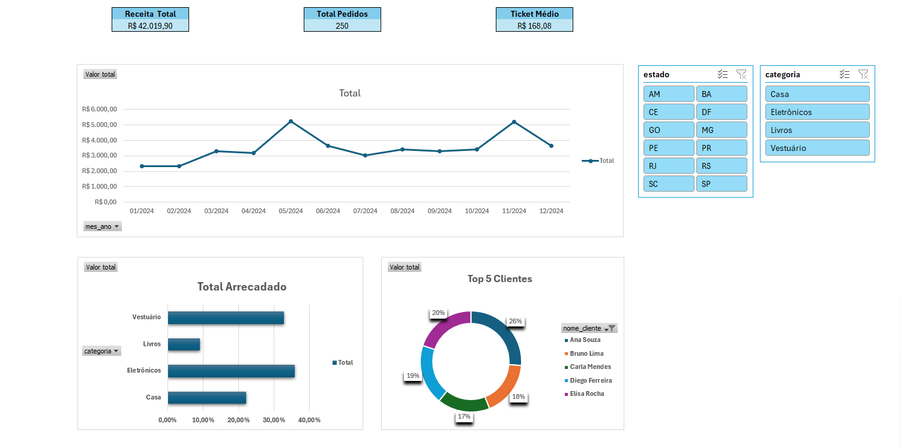

# Análise Comercial e Dashboard no Excel

## Contexto de Negócio
Este projeto faz parte de uma trilha de estudos para consolidar conhecimentos em Análise de Dados. O objetivo foi pegar os dados brutos de um e-commerce (extraídos via SQL no projeto anterior), realizar o tratamento, cruzar as informações e criar um dashboard executivo interativo no Excel para a diretoria.

## Ferramentas e Técnicas Utilizadas
- **Excel Avançado**: Tabelas estruturadas, Fórmulas (`SOMARPRODUTO`, `TEXTO`), Tratamento de dados (CSV e Power Query).
- **Tabelas Dinâmicas**: Agregação de faturamento por mês, estado, categoria e top clientes.
- **Dashboard Interativo**: Gráficos dinâmicos integrados com Segmentadores de Dados (Slicers).

## Estrutura do Repositório
- `vendas_brutas.csv`: Base de dados original exportada do PostgreSQL.
- `analise_ecommerce.xlsx`: Planilha final contendo a base tratada, as tabelas dinâmicas e o dashboard.
- `imagens/`: Prints do dashboard final.

## Principais Insights
- **Faturamento Total:** R$ 42.019,90.
- **Sazonalidade:** A empresa tem picos claros de vendas nos meses de Maio (Dia das Mães) e Novembro (Black Friday).
- **Geografia:** O estado de São Paulo (SP) é o principal mercado consumidor.
- **Mix de Produtos:** As categorias de Eletrônicos e Vestuário representam quase 70% de toda a receita.
- **Top Clientes:** O Top 5 clientes (liderado por Ana Souza) tem uma representatividade tão alta que justifica a criação de campanhas de fidelidade (CRM).

## Visualização do Dashboard

---
*Nota: A coluna `valor_total` foi calculada baseando-se na multiplicação de `preco_venda` por `quantidade`.*
